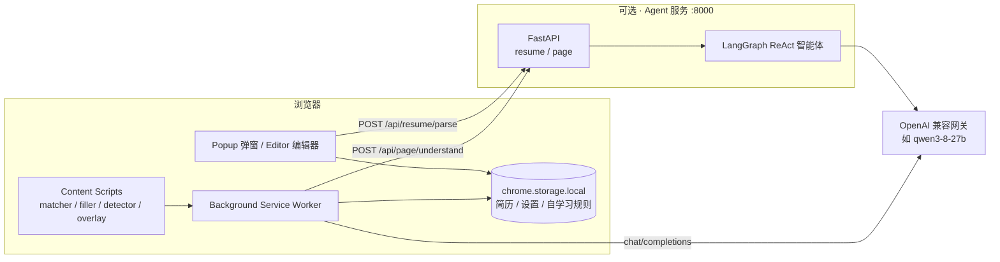
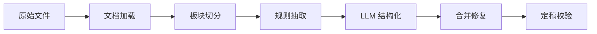
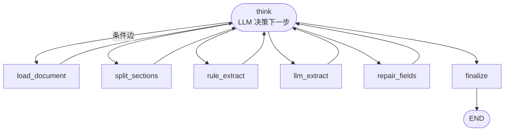
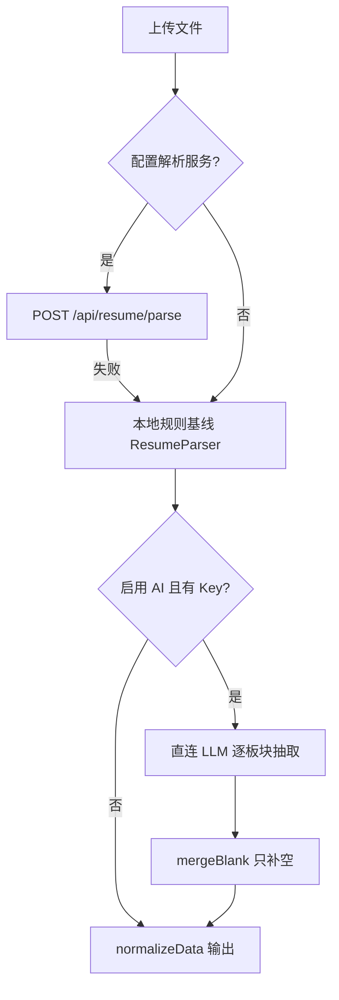
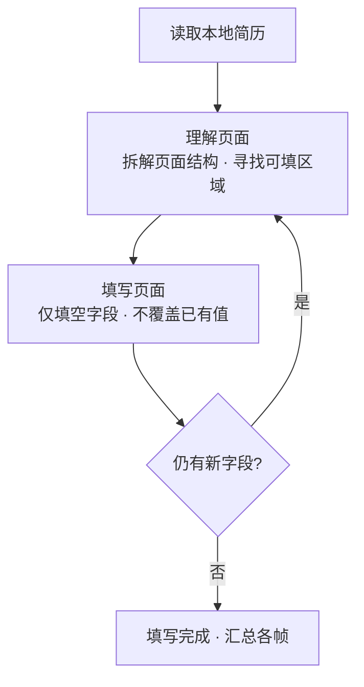
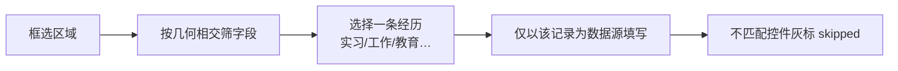

# 央国企网申速填 · 架构设计

> 对标 [来个简历自动填写助手（cv.playoffer.cn）](https://cv.playoffer.cn/) 的浏览器扩展。核心能力：**本地简历管理 → 智能简历解析（ReAct）→ 网页表单一键/选区/辅助填写**。

- 扩展（Manifest V3）：纯本地存储，负责表单识别、字段匹配与填写
- Agent 服务（FastAPI + LangGraph）：可自建的解析服务，DOCX 表格感知 + 规则 + LLM 结构化
- 无状态设计：密钥与简历不经过服务落盘，插件每次请求携带其设置页的 AI 配置

---

## 1. 总体架构



消息流：

| 方向 | 消息 | 作用 |
|---|---|---|
| Content → Background | `frame:fill` / `frame:clear` | 用户点击一键填写 / 停止 |
| Background → Content | `doFill` / `doClear` | 向所有帧下发填写指令 |
| Content → Background | `frame:fillDone` / `frame:fillSummary` | 各帧结果上报，点球帧汇总 |
| Content → Background | `ai:pageUnderstand` / `ai:chat` | 页面理解 / 通用对话 |
| Popup/Editor → Server | `POST /api/resume/parse` | 上传简历智能解析 |
| 任意帧 → Server | `POST /api/page/understand` | 表单字段 → 简历路径映射 |

---

## 2. 简历解析链路（ReAct）

### 2.1 问题根因

旧版导入解析**完全没有 AI 参与**，且存在两个结构性缺陷：

1. DOCX 的 `xmlToText` 粗暴剥离所有 XML 标签，把表格（`w:tbl`）中相邻的「标签单元格 / 值单元格」拆成互不相干的独立行；而 KV 正则要求「标签：值」在同一行，导致表格型简历的姓名/性别等**永远匹配失败**。
2. 姓名兜底仅检查首行是否恰好 2–4 个汉字；性别无任何推断手段。

### 2.2 三阶段预处理（对标 SmartResume）



| 阶段 | 实现 | 说明 |
|---|---|---|
| 文档加载 | `loaders/docx_loader.py`（python-docx） | 按 body 顺序遍历段落/表格；**表格感知**：标签/值配对、记录型表头（家庭成员/教育列表） |
|  | `loaders/pdf_loader.py`（pdfplumber） | 文本 + 表格；文本少于 20 字判定为扫描件并触发 OCR |
|  | `loaders/ocr.py` | PaddleOCR 优先，Tesseract 兜底 |
| 板块切分 | `match_section_title` | 按标题（基本信息/教育/工作/实习/项目…）归组，保留 `##` 标记 |
| 规则抽取 | `rules/extractor.py` | 正则 KV + 身份证校验位推断（性别/生日/年龄/省份）+ 行政区归一 |
| LLM 结构化 | `agent/tools.py::llm_extract` | 逐板块 `with_structured_output`，失败注入 JSON Schema 纯文本兜底 |
| 合并修复 | `services/merge.py` + `repair_fields` | 规则优先、LLM 只补空；对缺失字段定向补证 |
| 定稿校验 | `services/validate.py` | 教育经历排序、最高学历回填、性别/生日与身份证一致性检查 |

### 2.3 ReAct 智能体（LangGraph）

遵循 **思考（Thought）→ 行动（Action）→ 观察（Observation）** 范式：



**状态** `ResumeParseState`（`agent/state.py`）：

| 字段 | 类型 | 说明 |
|---|---|---|
| `document` | NormalizedDocument | 统一块模型（段落/表格/键值/记录） |
| `section_map` | `dict[str,str]` | 板块 key → 文本 |
| `rule_result` / `llm_result` | dict | 两层抽取结果 |
| `draft` | dict | 合并后的草稿 |
| `confidence` | `dict[str,float]` | 字段路径 → 置信度 |
| `missing` / `warnings` | list | 缺失项 / 警告 |
| `observations` | `list[{action,observation}]` | 完整思考轨迹 |
| `iteration` / `next_action` | int / str | 轮次（默认上限 12）/ 下一动作 |

**工具节点（可被大模型调用的 Action）**：

| Action | 函数 | 职责 |
|---|---|---|
| `load_document` | `tools.load_document` | DOCX/PDF/TXT/OCR 加载为统一块 |
| `split_sections` | `tools.split_sections` | 按板块归组 |
| `rule_extract` | `tools.rule_extract` | 确定性规则抽取（高置信基线） |
| `llm_extract` | `tools.llm_extract` | 逐板块结构化，支持长文分块 |
| `repair_fields` | `tools.repair_fields` | 合并后对缺失字段定向补证 |
| `finalize` | `tools.finalize` | 合并、校验、回填、输出 |

**路由（think 节点）**：LLM 输出 `ActionPlan{thought, action, reason}`；若模型不可用或输出非法，自动走确定性默认动作链：

```text
load_document → split_sections → rule_extract → llm_extract → repair_fields → finalize
```

**健壮性设计**：

- 结构化抽取：`with_structured_output`（json_schema / function calling）失败 → 注入 JSON Schema 纯文本兜底 → 解析失败带修复重试
- 优雅降级：单板块 LLM 失败仅跳过该板块；整体 LLM 不可用时回退规则结果，图绝不因连接错误终止
- 服务无状态：插件每次请求携带 `LLMConfig{base_url, api_key, model}`，环境变量仅兜底

### 2.4 插件端三级解析兜底

`lib/agent-client.js::parseResumeWithAgent`：



DOCX 本地解析（`lib/resume-parser.js`）同样表格感知：`w:body` 顺序遍历，`w:tbl` 中标签/值单元格配对、记录型表头识别；身份证号推断性别/生日/年龄；姓名由 docx 作者 → 文件名 → 首个标题前短中文行多级兜底。

---

## 3. 网页填写：三种模式

### 3.1 一键填写（doFill）

多轮循环，每轮闭环「理解页面 → 填写页面」：



- 顶层帧最多 3 轮、子帧 1 轮（动态表单逐步渲染）
- 只对**未处理且为空**的字段填写，**绝不覆盖用户已有输入**
- 支持 iframe（`all_frames=true`）：点球帧为 lead，汇总子帧结果
- AI 参与：`ai:pageUnderstand` 对未匹配字段做语义映射（含选项/控件类型）

### 3.2 选区填写（一次只填一组）



- **单组约束**：框选时只能圈一组；一次框两组会导致经历重复（数据源只取选中的一条记录）
- 路径用 `sec.*.field` 聚合格式，值仍取自该条记录；命中的无关控件标灰「不属于这一组」

### 3.3 辅助填写（逐项补填）

针对 AI 未识别到的组件（如户口所在地、居住地址）：

- 列出简历中**全部非空值**（对象段 `sec.field`、数组段 `sec.index.field`）
- 选中条目 → 点击目标控件 → `setTextValue` 填入；兼容自定义下拉/级联
- 值同时复制到剪贴板，填入失败可手动粘贴

---

## 4. 选型依据（含来源）

| 方向 | 方案 | 结论 |
|---|---|---|
| 商业解析 | 北森（自称综合准确率 98%）、RChilli（200+ 字段 / 300ms / 40+ 语言）、Affinda（95%+ / 50ms） | 面向企业付费，不适合个人插件场景，仅作准确率参照 |
| 开源架构 | 阿里 SmartResume：OCR + PDF 元数据 + YOLOv10 版面检测 + Qwen3 结构化 | 采纳其三阶段思路（预处理 → 版面/阅读顺序 → LLM 结构化） |
| 文档底座 | Docling（TableFormer 表格、DOCX 好）、MinerU（中文/学术精度高）、unstructured（格式覆盖广） | DOCX 用 python-docx 表格感知，PDF 用 pdfplumber；复杂版面可切换 Docling |
| 编排 | LangGraph | 状态图天然契合 ReAct 循环与条件路由 |
| 抽取策略 | 规则 + LLM | 联系方式/身份证等确定性字段用规则（更稳），LLM 只补空、不编造 |

参考链接：

- 北森简历解析：https://www.beisen.com/res/866.html
- RChilli Resume Parser：https://docs.rchilli.com/kc/c_RChilli_resume_parser
- Affinda Resume Parser：https://www.affinda.com/resume-parser/?method=individual
- Docling：https://docling.org/
- SmartResume 相关解析：https://blog.csdn.net/Liudef06/article/details/154490760
- 对标产品帮助：https://cv.playoffer.cn/help

---

## 5. 部署

### 5.1 本地运行

```bash
cd agent-server
python -m venv .venv
.venv\Scripts\activate                 # Windows；Linux/macOS: source .venv/bin/activate
pip install -r requirements.txt
uvicorn app.main:app --host 0.0.0.0 --port 8000
```

扫描件再装 OCR：`pip install -r requirements-ocr.txt`

扩展设置页填写：

- 解析服务地址：`http://localhost:8000`（本地）或 `http://你的服务器:8000`
- API 地址 / Key / 模型：OpenAI 兼容网关（填到主机端口或带 `/v1` 均可）

### 5.2 Docker

```bash
docker build -t qf-agent agent-server
docker run -d --name qf-agent -p 8000:8000 qf-agent
```

### 5.3 systemd + Nginx（服务器常驻）

```ini
# /etc/systemd/system/qf-agent.service
[Unit]
Description=qf-agent
After=network.target

[Service]
WorkingDirectory=/opt/qf-agent
ExecStart=/opt/qf-agent/.venv/bin/uvicorn app.main:app --host 127.0.0.1 --port 8000
Restart=always

[Install]
WantedBy=multi-user.target
```

```bash
systemctl enable --now qf-agent
```

Nginx 反代 `127.0.0.1:8000`，插件解析服务地址填 `http://域名或IP:端口`。

---

## 6. 目录结构

```
job_chajian/
├── manifest.json
├── background.js                 # 消息中枢：ai:chat / ai:pageUnderstand / 帧调度
├── lib/
│   ├── resume-schema.js          # 简历 schema（单一事实来源）
│   ├── resume-parser.js          # 本地 DOCX 表格感知 / 身份证推断 / 多级兜底
│   ├── agent-client.js           # 解析服务客户端 + 直连 LLM 抽取
│   ├── storage.js / rules.js
│   └── vendor/pdf.min.js
├── content/
│   ├── matcher.js                # 字段采集与匹配
│   ├── filler.js                 # 填写（含自定义下拉/级联）
│   ├── detector.js               # 招聘表单识别
│   └── content-main.js           # 内容侧编排 + 三种填写模式
├── popup/                        # popup / editor / records
├── agent-server/
│   ├── app/
│   │   ├── main.py / config.py
│   │   ├── schemas/              # LLMConfig / 简历模型 / 页面模型
│   │   ├── loaders/              # docx / pdf / text / ocr / 表格配对
│   │   ├── rules/                # patterns / idcard / region / extractor
│   │   ├── agent/                # state / llm / prompts / tools / graph
│   │   └── services/             # merge / validate / page_service
│   ├── tests/rule_smoke.py
│   ├── Dockerfile / requirements.txt
│   └── README.md
└── ARCHITECTURE.md
```

---

## 7. 验证记录

- 模块导入 & LangGraph 图构建：通过
- 规则路径（`test/sample-resume.docx`，不调 LLM）：姓名「张三」、性别「男」、教育 2 条（南京大学/上海交通大学，含学校/学历/专业/学位/起止/课程）、工作/实习/项目各 1 条
- 全图无 LLM fallback：think 失败走默认动作链，成功定稿
- HTTP 接口：`/health`、`POST /api/resume/parse` 实测通过
- JS 语法：`node --check` 全部改动文件通过
